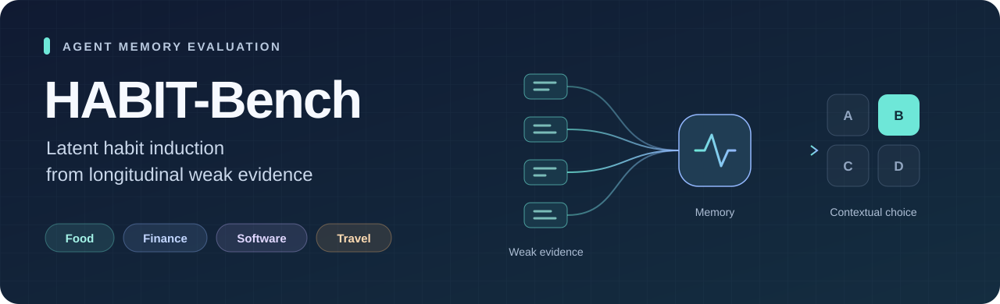
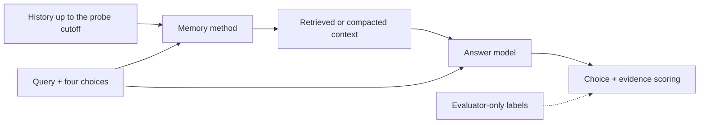

<p align="center">
  
</p>

<p align="center">
  <strong>Evaluating Habit Induction from Longitudinal Weak Evidence in Agent Memory</strong>
</p>

<p align="center">
  
  
  
  
</p>

<p align="center">
  <a href="#overview">Overview</a> ·
  <a href="#datasets">Datasets</a> ·
  <a href="#quick-start">Quick start</a> ·
  <a href="#supported-methods">Methods</a> ·
  <a href="#model-interface">Model interface</a> ·
  <a href="#custom-memory-methods">Extend</a>
</p>

## Overview

**Can a memory agent infer a user's latent habits from repeated weak evidence—and recognize when those habits apply?**

HABIT-Bench studies this question through longitudinal synthetic user histories in Food, Finance, Software, and Travel. Each probe asks an agent to select one of four actions using only the history available at that point in time. Every probe has one deterministic gold choice.

The benchmark examines habit induction, applicability boundaries, exception retention, temporal drift, and rejection of nonbinding evidence. These distinctions help identify why an agent chooses the wrong action, including when it makes an unsupported personalization.



This repository provides the shared evaluator, memory-method implementations and adapters, and main experiment configurations.

## Datasets

| Domain | Synthetic users | Sessions | Probes |
|:--|--:|--:|--:|
| Food | 30 | 3,900 | 630 |
| Finance | 36 | 19,440 | 1,368 |
| Software | 18 | 9,720 | 680 |
| Travel | 30 | 4,092 | 650 |
| **Total** | **114** | **37,152** | **3,328** |

**Data availability:** the four-domain dataset package is distributed separately as supplementary material. Dataset files and model weights are not included in this repository.

| File in each domain | Contents | Used by |
|:--|:--|:--|
| `public/lifelines.jsonl` | Dialogue sessions in chronological order | Memory method |
| `public/probes.jsonl` | Queries, four choices, and history cutoffs | Evaluator and method adapter |
| `private/probe_key.jsonl` | Gold choices and diagnostic evidence annotations | Evaluator only |

The histories are synthetic. A probe's visible history is restricted to its user and to `session_index <= visible_history_scope.max_session_index`. Gold answers and private evidence labels are excluded from method inputs.

## Quick start

### 1. Install

The supplied dependency file records the main evaluation environment: **Python 3.11, Linux, and CUDA**. Use a separate environment for the model server.

```bash
git clone https://github.com/Hollyming/habit-bench.git
cd habit-bench
python3.11 -m venv .venv
source .venv/bin/activate
pip install -r requirements.txt
```

### 2. Prepare the data

Extract the supplementary dataset package into a sibling `datasets/` directory:

```text
workspace/
├── habit-bench/                 # This repository
└── datasets/
    ├── food/                   # public/ and private/
    ├── finance/
    ├── software/
    └── travel/
```

Validate all four domains, then check one run without loading models or making API calls:

```bash
python -m evaluation.validate \
  ../datasets/food ../datasets/finance ../datasets/software ../datasets/travel

python evaluate.py --method mem0 \
  --dataset-dir ../datasets/food --output-dir outputs/food/prepare \
  --prepare-only
```

The preparation step writes `method_input.json` and `run_manifest.json`.

### 3. Run an evaluation

Start an OpenAI-compatible Chat Completions server that serves your chosen model. The default configuration uses Qwen3-8B and a 40,000-token input budget; the server must allow that budget plus answer tokens.

```bash
export OPENAI_BASE_URL=http://127.0.0.1:8000/v1
export OPENAI_API_KEY=your_api_key

python evaluate.py --method mem0 \
  --dataset-dir ../datasets/food \
  --output-dir outputs/food/mem0 \
  --base-model Qwen3-8B \
  --base-model-path Qwen/Qwen3-8B
```

Change `--method` and `--dataset-dir` to compare methods and domains. Add `--max-probes 2` for a small smoke run; omit it for full evaluation. Use `python evaluate.py --help` for all options.

## Supported methods

| Method | CLI identifier | Included integration |
|:--|:--|:--|
| Mem0 | `mem0` | Benchmark reproduction |
| A-MEM | `amem` | Benchmark reproduction |
| MemOS | `memos` | Benchmark reproduction |
| MemRL | `memrl` | Benchmark reproduction |
| LightMem | `lightmem` | Benchmark reproduction |
| Letta | `letta` | Benchmark reproduction |
| MIRIX | `mirix` | Benchmark reproduction |
| SeCom | `secom` | Adapted implementation |
| Full-Memory | `full_memory` | History reference with online compaction |
| No-Memory | `no_memory` | Answer-model control |

Memory methods use the selected model for LLM-based memory operations where required. The default embedding model is BGE-M3, pinned to the revision in the code and configs. Override it with `--embedding-model` using a local model directory or Hugging Face model ID. Method settings are in [`configs/method_config/`](configs/method_config/).

## Model interface

The model server implements `POST /v1/chat/completions`.

| Interface | Requirements |
|:--|:--|
| Chat requests | `model`, `messages`, `temperature`, `max_tokens`, `seed`, and the selected `response_format` |
| Qwen configuration | Support for `chat_template_kwargs.enable_thinking`; thinking is disabled by default |
| Tool-using methods | Support for `tools`, `tool_choice`, `tool_calls`, and tool messages with `tool_call_id` |
| Final answer | Message content containing a choice object, such as `{"choice_id":"A"}` |

`--base-model` is the name exposed by the server. `--base-model-path` is the matching tokenizer directory or model ID. API keys are read from the environment or `--api-key` and redacted in run manifests. Methods such as MIRIX require tool calling in addition to basic chat completion.

### Evaluation settings

The default `--answer-protocol main` preserves the Qwen3 4B–32B main experiment reader. Defaults are temperature **0**, seed **42**, an input budget of **40,000 tokens**, and an initial answer budget of **64 tokens**. Full-Memory compacts history online, independently of the probe query, using an 8,192-token summary envelope plus recent raw sessions.

The alternative reader is selected explicitly:

```bash
python evaluate.py --method mem0 \
  --dataset-dir ../datasets/food --output-dir outputs/food/mem0-current \
  --base-model Qwen3-8B --base-model-path Qwen/Qwen3-8B \
  --answer-protocol current --answer-response-format json_schema
```

Report the answer protocol, model, method settings, and dataset with each result. The two readers have different prompts and parsing behavior.

<details>
<summary><strong>Resume an interrupted run</strong></summary>

Set the following variables and repeat the original command with the same output directory and settings:

```bash
export HABITBENCH_RESUME_PARTIAL=1
export HABITBENCH_MEMORY_USER_CHECKPOINTS=1
```

Checkpoint validation detects incompatible configurations. Use a new output directory when changing a run's settings.

</details>

## Outputs and scoring

| Output | Purpose |
|:--|:--|
| `run_manifest.json` | Dataset hashes, model and method configuration, and execution status |
| `memory_contexts.jsonl` | Context and evidence returned by the memory method |
| `predictions.jsonl` | Per-probe answers |
| `metrics.json` | Aggregate choice and evidence metrics |
| `metrics_by_group.csv` | Grouped metrics |
| `scored_predictions.jsonl` | Per-probe scoring details |

Choice accuracy uses exact choice-ID matching. Evidence scoring follows each domain's annotations and reports invalid or out-of-scope attributions. Keep per-domain results visible when reporting aggregates.

To score existing predictions:

```bash
python -m evaluation.score \
  --dataset-dir ../datasets/food --predictions predictions.jsonl \
  --output-dir outputs/scored --method-name mem0
```

Each prediction needs `probe_id` and `choice_id`; `evidence_session_ids` is optional.

## Custom memory methods

A custom adapter receives a public JSON payload containing `sessions_by_user` and `probes`. It must enforce each probe's visible-history cutoff, ingest sessions chronologically, and write one JSONL record per probe:

```json
{"probe_id":"food_probe_000001","memory_context":"retrieved memory","evidence_session_ids":["food_user_0001_session_0012"]}
```

The evaluator then runs the answer model and scores its predictions. The adapter returns memory context and optional evidence IDs; gold choices and scoring labels stay with the evaluator.

```bash
python evaluate.py --method-name my_memory \
  --dataset-dir ../datasets/food --output-dir outputs/food/my_memory \
  --adapter-command 'python my_adapter.py --input {input} --output {output}' \
  --base-model Qwen3-8B --base-model-path Qwen/Qwen3-8B
```

## Repository map

```text
evaluate.py          Main evaluation entry point
evaluation/          Dataset validation, answering, checkpoints, and scoring
methods/             Memory-method implementations and wrappers
configs/             Main method configurations
memory_adapter.py    Shared memory-method adapter
secom/               SeCom implementation
secom_adapter.py     SeCom adapter
src/ · utils/        Shared method support
LICENSES/            Retained upstream license notices
```

## Acknowledgments and licenses

HABIT-Bench integrates work from the memory methods listed above. Their applicable license notices are retained in [`LICENSES/`](LICENSES/) and the corresponding source files. Consult those notices when reusing individual components. Dataset source material is subject to its own terms, described in the separate dataset package.
